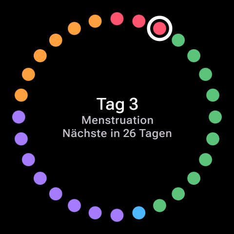
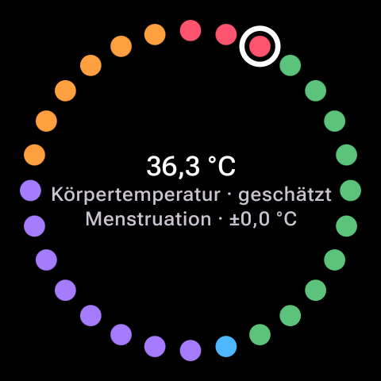
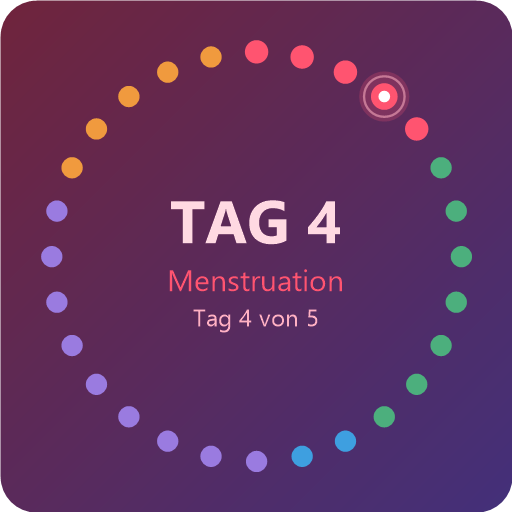

# WatchPeriod

Zyklus-Tracker für **Wear OS** und **Android** – alles bleibt auf den eigenen Geräten.
Kein Konto, keine Cloud, keine Internet-Berechtigung.

<p align="center">
  
  
  
</p>

## Screenshots

| Uhr – Zyklusring | Uhr – Körpertemperatur | Handy – Widget |
| :---: | :---: | :---: |
|  |  |  |
| Ein Punkt pro Zyklustag, eingefärbt nach Phase | Schätzung, Verlauf und Abweichung zur Follikelphase | Gleicher Ring als Homescreen-Widget |

## Funktionen

### Auf der Uhr

- **Zyklusring**: ein Punkt pro Zyklustag, farblich nach Phase – Menstruation (rot, Prognose transparent),
  Follikelphase (grün), Eisprung (blau), Lutealphase (violett), späte Lutealphase (orange).
- **Zentrum**: Antippen wechselt zwischen Zusammenfassung, Hormonverlauf, Stimmung und Körpertemperatur.
- **Bedienung**: Krone (Rotary) wählt den Tag, langes Drücken auf einen Punkt öffnet das Tagesmenü,
  Wischen nach rechts öffnet das Menü.
- **Kachel**: kompakter Ring; langes Drücken auf einen Punkt springt per Deep-Link
  (`watchperiod://day/<datum>`) direkt in den Tag.
- **Komplikation** „Nächste Periode“ für das Watchface (Short Text, stündliches Update).
- **Menü**: Periode begann/endete heute, Heute erfassen, Auswertung, Für Partner, Hormone,
  Körpertemperatur, Verlauf, sichtbare Hormone ein-/ausschalten, Periode nachtragen, Einstellungen.

### Auf dem Handy

- **Heute** – Zyklusring, Kennzahlen, Schnell-Erfassen, Hormone, Stimmungs-Übersicht.
- **Kalender** – Perioden eintragen und bestätigen, errechneter nächster Start.
- **Auswertung** – Zyklus in Zahlen, Hormonverlauf, Temperatur, Stimmungs-Statistik, Wissen (PMDD/PMDS, Quellen).
- **Mehr** – Zykluslänge (automatisch aus den Perioden), Periodendauer, sichtbare Hormone, Sync-Status.
- **Widget** „Zyklusring“ für den Homescreen.

## Aufbau

| Modul | Inhalt |
| --- | --- |
| `domain` | Reine Kotlin/JVM-Logik, von Uhr und Handy gemeinsam genutzt: `CycleCalculator`, `HormoneEstimator`, `TemperatureEstimator`, `EventAnalytics`, Modell (`Mood`, `Events`, `Hormone`, `Sources`, `PmddInfo`, `PartnerInfo`) sowie `SyncSnapshot`/`SyncCodec`. |
| `mobile` | Handy-App (Jetpack Compose, Material 3): Start, Kalender, Auswertung, Einstellungen, Homescreen-Widget, `PhoneSync`. |
| `wear` | Wear-OS-App (Compose for Wear OS Material 3): Zyklusring, Menü, Kachel (Protolayout), Komplikation, `WatchSync`. |

## Daten und Synchronisation

- Jede Seite speichert lokal in SQLite (`period.db`) – gleiches Schema auf Uhr und Handy.
- Beim Start und nach jeder Änderung schickt das Gerät einen **gzip-gepackten JSON-Snapshot** über die
  Wearable Data Layer (`/watchperiod/snapshot`, `/watchperiod/request`).
- Ganzzahlige **Revision** pro Änderung: Es gewinnt der Snapshot mit der höheren Revision. So kann ein
  alter Eintrag auf dem anderen Gerät neuere Daten nicht überschreiben.

## Datenschutz

- Keine Konten, keine Server, kein Tracking – beide Manifeste fordern **keine `INTERNET`-Berechtigung**.
- Der Abgleich läuft ausschließlich direkt zwischen den gekoppelten Geräten (Bluetooth/WLAN).
- Alle Einträge bleiben in der lokalen Datenbank auf Uhr und Handy; die App kann jederzeit durch
  Deinstallieren vollständig entfernt werden.

## Technik

- Kotlin 2.2, Jetpack Compose (Material 3) und Compose for Wear OS
- Wear Tiles (Tiles 1.5, ProtoLayout 1.3) und Watch-Face-Complications
- Wearable Data Layer (`play-services-wearable`)
- `minSdk 30`, `compileSdk`/`targetSdk 37`, AGP 9.5, Gradle 9.6

## Bauen

Voraussetzung: Android Studio mit installiertem SDK 37 und JDK 25 (Toolchain laut `gradle/gradle-daemon-jvm.properties`).
`local.properties` mit `sdk.dir=…` wird von Android Studio automatisch angelegt und ist nicht im Repo.

```powershell
$env:JAVA_HOME = 'C:\Program Files\Android\Android Studio\jbr'
$env:Path = "$env:JAVA_HOME\bin;$env:Path"

.\gradlew.bat :domain:test
.\gradlew.bat :wear:assembleDebug
.\gradlew.bat :mobile:assembleDebug
```

## Installieren

```powershell
adb install -r wear\build\outputs\apk\debug\wear-debug.apk
adb install -r mobile\build\outputs\apk\debug\mobile-debug.apk
```

Uhr und Handy müssen gekoppelt sein, damit der Abgleich funktioniert. Die laufende Uhr-App fragt den
Stand beim Start selbst nach; alternativ in der Handy-App unter **Mehr › Jetzt synchronisieren**.

## Hinweise

Hormon- und Temperaturwerte sind **schematische Schätzungen** aus der Zykluslänge – keine Messung,
kein Diagnoseinstrument und nicht zur Verhütung geeignet. PMDD/PMDS-Informationen ersetzen keine
ärztliche Beratung.

## Beitragen

Issues und Pull Requests sind willkommen. Bitte keine Screenshots mit echten Zyklusdaten, Konten oder
Standorten beilegen.
